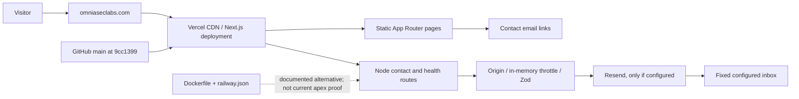

# Omniasec Labs — baseline audit

Audit date: 2026-10-15 UTC. Scope: Phases 0–1, with the Phase 2 architecture proposal. Source baseline: [`9cc1399fb1ca9642d5f91c898e0f533e85aae5fc`](https://github.com/Syedsaadhhh/Omnia_Universal/commit/9cc1399fb1ca9642d5f91c898e0f533e85aae5fc).

This checkpoint adds documentation and evidence only. Application code, dependencies, deployment settings, DNS, email configuration, existing projects, and `main` are unchanged. No deployment, merge, production POST, real email, intrusive scan, or paid resource was initiated.

## Verified source and production linkage

| Item | Evidence | Conclusion |
| --- | --- | --- |
| Connected GitHub actor | Connector `get_user_login` and `gh api user` both returned `Syedsaadhhh` | Correct requested account |
| Repository | Git clone and GitHub API: `Syedsaadhhh/Omnia_Universal`, public, not archived; API permissions include admin/push | Authorized source accessible; individual administration endpoints remain scope-limited |
| Default branch | Repository API and `origin/HEAD`: `main` | Verified, not inferred from the brief |
| Source commit | `git rev-parse HEAD`: `9cc1399fb1ca9642d5f91c898e0f533e85aae5fc` | Latest baseline main commit, subject: “Replace unconfigured contact form with working business email” |
| Production provider | Vercel team `syedsaadhhhs-projects`, project `omniaseclabs.ai`, ID `prj_NWhj0oMX8aDwSo93bs3tMEkYCTsE` | Current apex site is on Vercel; Railway configuration alone is not deployment evidence |
| Production domain assignment | Authenticated Vercel project-domain inspection: `omniaseclabs.com`, verified, above project ID | Apex mapping verified |
| Production revision | Vercel deployment `dpl_8RmUj4RirHa6JEiuoY5gZStoZFr4`, READY, target `production`; metadata identifies this repo, `main`, and full baseline SHA; aliases include apex | Source-to-deployment linkage verified independently of page similarity |
| Deployment history | GitHub deployment `6768345233`, success 2026-09-30; deployment URL matches Vercel record | Corroborates current deployment |
| Other build integration | Current GitHub check `Workers Builds: omniaseclabs`: failure; Vercel commit status: success | Cloudflare integration also exists. Its failure cause, domain role, and necessity are unverified |

Vercel's project response also contained `live: false`; this field is not used as a health verdict. The READY deployment, apex assignment, HTTP response, and rendered browser pages establish the observed serving state.

## Environment and reproducibility

Managed cloud environment reported connected/running, current observations, unrestricted HTTP policy enforced, and no configured runtime secret bindings or outbound identities. `/etc/codex/network-policy.json` matched that policy; VPN was not configured. GitHub and Vercel connectors authenticated separately. No credentials were requested or printed.

Local checkout: `/workspace/Omnia_Universal`. No applicable `AGENTS.md`, `PRODUCT.md`, or `DESIGN.md` was found. Node `v24.19.0`, npm `11.9.0`, Python Playwright, and Chromium were available. Vercel project specifies Node `24.x`; Docker specifies Node `22-alpine`. Container build/runtime was not exercised. No Railway or Cloudflare administration access was established.

The untouched source was copied to `/tmp/omnia-audit-runtime` for dependency installation, generated build output, local HTTP validation, and mocked provider tests. A lockfile was generated **only in that isolated copy** to run dependency auditing. The snapshot in `docs/audit/evidence/resolved-package-lock.json` records this audit resolution; it is not an approved root lockfile or a reconstruction of production's installed dependency tree.

| Package | Declared | Isolated resolution |
| --- | --- | --- |
| Next.js | `16.2.9` | `16.2.9` |
| React / React DOM | `^19.2.0` | `19.3.1` / `19.3.1` |
| Resend | `^6.1.0` | `6.33.0` |
| Zod | `^4.1.0` | `4.6.7` |
| TypeScript | `^5.9.0` | `5.9.3` |
| PostCSS override | `8.5.10` | `8.5.10` |
| Sharp (transitive) | Next.js dependency | `0.34.5` |

Registry `/latest` responses at audit time: Next `16.4.2`, React `19.3.1`, PostCSS `8.5.30`, Sharp `0.35.5`. These are candidates for evaluated fixes, not instructions to upgrade everything. An `npm view` metadata lookup stalled and was stopped; direct registry responses and the completed dependency audit supplied the recorded versions.

## Architecture and complete tracked inventory

All 52 baseline tracked files are indexed by path, byte size, and SHA-256 in [source inventory](docs/audit/evidence/source-inventory.json). Review covered all routes, shared components, content configuration, seven imported CSS files, SVG assets, TypeScript/build configuration, Docker/Railway configuration, environment example, ignore rules, README/deployment docs, all remote branch tips, and recent history. There are no baseline test files, test script, lockfile, `.github` directory, middleware/proxy file, Server Actions, database, login flow, or application persistence layer.

Important boundaries:

- `lib/site.ts` duplicates projects across `projectShowcase`, `projects`, and `labTools`; free-text maturity and narrow category unions are not backed by an evidence model.
- `Header`, `ProjectsGallery`, `NetworkCanvas`, and dormant `ContactForm` are client components. Normal pages use server rendering/static generation. There is no observed third-party runtime font/script dependency.
- `/contact` renders mailto links, not `ContactForm`. `POST /api/contact` still exists. Its real configuration/delivery was not exercised.
- Contact delivery destination and sender are environment-controlled; visitor input is used for `replyTo`, subject, and escaped message content. It is not an arbitrary-recipient mail relay.
- `/api/health` reports process/routing liveness only; it does not establish email delivery or provider readiness.
- Organization JSON-LD uses `JSON.stringify` without `<` escaping. Current fields are trusted source/environment values; no untrusted runtime data flow was found. No demonstrated XSS is claimed.

## Live route inventory

| Route | Observed response | Function / notable evidence |
| --- | --- | --- |
| `/` | 200 | AI/cybersecurity hero, simulated execution trace, ReproForge-led homepage |
| `/projects` | 200 | 11 cards; All/Flagship/Hackathons/Security Tools filters |
| `/research` | 200 | Four agent/AI/cyber questions; prospective publications |
| `/about` | 200 | Founder Syed Saad; portrait presented through CSS background while semantic image is hidden |
| `/build-log` | 200 | Three older entries; outcome claims need linked evidence before broader reuse |
| `/contact` | 200 | Mailto `contact@omniaseclabs.com`; no form |
| `/security` | 200 | Operating principles and disclosure email; not proof of implemented product controls |
| `/privacy` | 200 | Describes form collection/provider handling despite mailto-only UI |
| `/terms` | 200 | Emerging-lab limitations, prototype disclaimers, external-link boundaries |
| `/gns3-agent` | 200 | Legacy flagship/implemented/planned claims and early-access links |
| `/api/health` | 200 GET | `{"status":"ok","service":"omnia-sec-ai-labs"}` |
| `/api/contact` | 405 GET | Expected method rejection; production POST deliberately untested |
| `/robots.txt` | 200 | Host and sitemap reference old Vercel origin |
| `/sitemap.xml` | 200 | All ten URLs reference old Vercel origin |
| `/manifest.webmanifest` | 200 | Old brand and narrow description |

All ten content pages use canonical `https://omniaseclabsai.vercel.app` with no page-specific path. This is a deployed defect, not just a hypothetical missing environment setting. Actual build-time/runtime variable values were not read.

## DNS, HTTPS, headers, email

DNS was checked using system resolution and Google Public DNS over HTTPS. Apex A: `216.198.79.1`; `www` A: `66.223.49.89`. No AAAA or CNAME answer was returned for either name. Authoritative NS names returned `ns1.hosting.businessidentity.llc` and `ns2.hosting.businessidentity.llc`.

- Apex HTTP returns 308 to HTTPS; HTTPS returns 200 and renders in Chromium.
- `www` returned an upstream-connection 503 through HTTP clients and independently through Chromium. Both tests originate from this cloud environment. Different DNS is confirmed; public downtime, origin certificate failure, or intended `www` behavior is **not** established. Owner/provider-side verification is required before any DNS recommendation becomes a change.
- Browser TLS details showed TLS 1.3 and the environment's `openai.com` issuer. This is an intercepted connection; the origin certificate issuer, expiry, and public certificate chain were not independently validated. Certificate verification remained enabled.
- Live apex responses include CSP, frame denial, nosniff, referrer/permissions policies, COOP, and CORP. HSTS is already `max-age=63072000`, without `includeSubDomains`. No blanket HSTS expansion is proposed.
- CSP permits inline scripts/styles. This weakens defense in depth, but no injection source or exploit was demonstrated. Static page `Access-Control-Allow-Origin: *` is not evidence of credentialed API CORS exposure.
- MX points to `mailserver.businessidentity.llc`; SPF includes `spf.postal.businessidentity.llc` with `~all`; DMARC publishes `p=quarantine`. The single checked Resend selector `resend._domainkey` returned NXDOMAIN. DKIM may use another selector/subdomain: this is **not** evidence of absent DKIM. Inbox delivery, sender authorization, Resend verification, mailbox permissions, and retention require approved provider access.

## GitHub and operational controls

Seven remote branches were listed, including `main`, `production-site`, and `pre-overhaul-2026-09-16`; all branch responses reported `protected: false`. Repository rulesets returned `[]`. Workflow and run APIs both returned total count zero. GitHub Production and Preview environments had no protection rules or branch policy. These verify a lack of visible required-check/review gates; they do not establish every provider-side permission or policy.

Detailed branch protection, secret-scanning alerts, vulnerability-alert status, automated-security-fix status, and webhook administration returned integration-scope 403 errors. The Dependabot-alert endpoint specifically stated that alerts are disabled. No settings were enabled or changed. Vercel reports SSO protection for all except custom domains; the public apex is intentionally accessible. The existence of Vercel Git deployment automation means a push/PR can trigger a preview: this audit branch remains local pending the checkpoint.

A value-suppressing scan of 85 unique reachable historical Git blobs found no matches for the tested private-key, GitHub-token, AWS-key-ID, Resend-key, and quoted generic-secret patterns. Only `.env.example` and `next-env.d.ts` are tracked environment-related paths. This is a bounded pattern scan, not proof that history is secret-free. `.env.production` and `.env.staging` are not ignored; `.env`, `.env.local`, and `.env.production.local` are ignored. Docker excludes `.env*`.

## Actual validation results

| Check | Actual outcome | Scope / evidence |
| --- | --- | --- |
| `npm install --package-lock=false --ignore-scripts --no-fund --no-audit` | Exit 0 | Isolated copy; no production secrets |
| `npm run typecheck` | Exit 0 | [log](docs/audit/evidence/typecheck.txt), Node 24 |
| `NEXT_TELEMETRY_DISABLED=1 npm run build` | Exit 0 | [log](docs/audit/evidence/build.txt), 18 generated entries including metadata/framework routes |
| Baseline `npm audit --package-lock-only --json` | Exit 1, `ENOLOCK` | No baseline lockfile; not a clean audit |
| Isolated lock generation then `npm audit --json` | Exit 1 | 3 affected package entries: Next critical, PostCSS high, Sharp high; these are package counts, not three independently proven site exploits |
| Existing automated tests | None available | No fabricated baseline test pass count |
| Actual contact handler, Resend mocked | 24/24 assertions matched observed behavior | [results](docs/audit/evidence/contact-results.json); includes assertions demonstrating defects, not a security pass |
| Local production HTTP contact checks | 403 cross-origin, 500 malformed JSON, 500 JSON null, 503 for otherwise-valid 1 MiB body without provider settings | [results](docs/audit/evidence/contact-http.json); no mail sent |
| Public browser route capture | 30/30 pages: HTTP 200, zero page exceptions, zero broken images, no page-level horizontal overflow | 10 routes × 1440×1000, 768×1024, 390×844; reduced-motion captures |
| Local interactions | Menu opens and navigation closes it; filters show 11/4/6/7 cards | Escape-close check failed; hidden menu links remained focusable |
| Axe WCAG A/AA subset | Desktop: label/name issue on two shared brand links across four sampled pages; mobile sample: no automated violations | Eight scans; incomplete checks retained. Not WCAG certification |
| Internal route/fragment checker | 284 link occurrences across 10 pages; no broken internal targets | External links enumerated but not availability- or ownership-verified |

## Conclusions and next checkpoint

See [severity-ranked findings](SECURITY_FINDINGS.md), [positioning and wireframes](POSITIONING_AND_IA.md), [phased plan](IMPLEMENTATION_PLAN.md), and [resumption state](WORK_STATE.md). The first work should address dependency exposure, reproducibility, and release gates; then API/metadata/privacy issues and the broad public narrative.

The apex site is currently reachable. No critical exploitable production vulnerability was established. Critical dependency advisories still warrant prompt evaluated remediation. Missing infrastructure evidence must not be silently converted into findings of outage, exploitation, missing credentials, or safe configuration.
